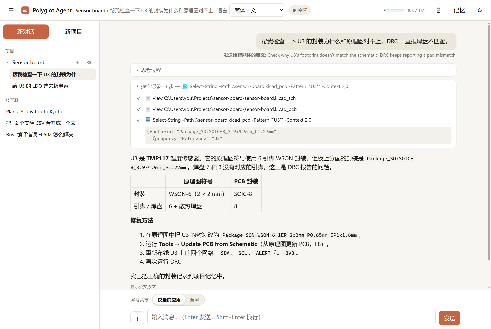
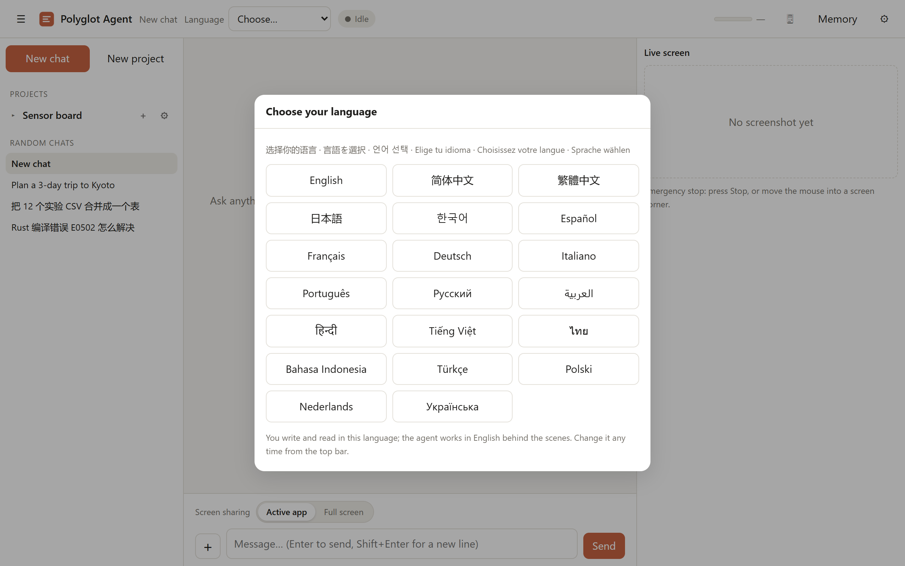
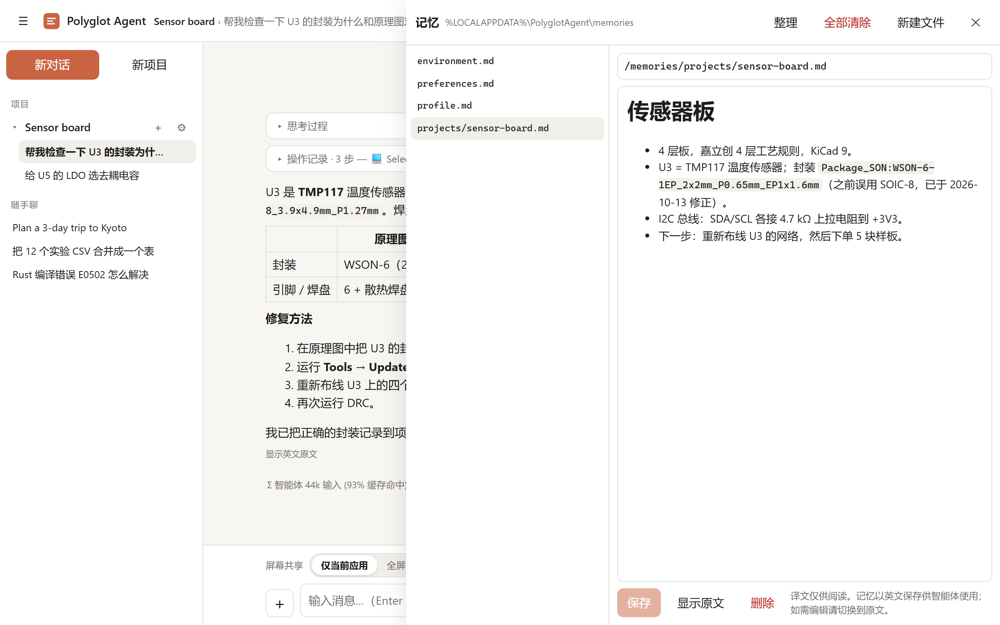
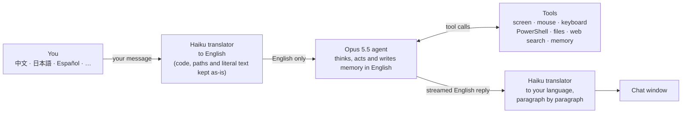
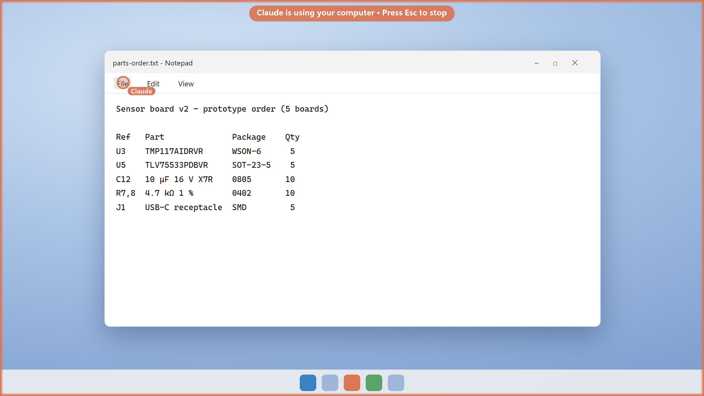

# Polyglot Agent

A local computer-use assistant for Windows that you can talk to in any language.

<p align="center">
  
</p>
<p align="center"><sub>Ask in your language. The agent works in English (shown under your message), reads the project files, and its reply comes back translated. The sample project and chats are made up.</sub></p>

- **Main agent:** `claude-opus-5-5` at **high** effort, with adaptive thinking (summaries shown in the UI).
- **Your language, chosen by you:** on first launch you pick your language from a list. The app never detects or guesses it from your text, browser or Windows settings. Change it any time in the top bar.
- **Translation layer:** `claude-haiku-5-5` translates your message into English before the agent sees it, and translates the agent's English reply back into your language while it streams, one paragraph at a time.
- **Tools:** computer control (`computer_toolset_20260801`: screenshots, zoom, mouse, keyboard; **off by default**, turn it on in ⚙ Settings → *Tools*), PowerShell, file view/edit, web search, and a persistent **memory** (`memory_20250818`).
- **Memory:** the agent saves what it learns about you and your projects (PCB boards, codebases, lab setups, preferences) as it works. After each request, a background reviewer also updates `/memories`. You can browse and edit everything in the **Memory** panel. Memory is stored in English; click **Translate** there to read it in your language (read-only, cached; **Show original** to edit). **Tidy up** has an AI pass merge duplicates and drop outdated lines; **Clear all** deletes every memory file. Both save a backup first (in `memories-backups` in the data folder, which the agent can't see), and **Undo** puts it back.
- **Projects and chats:** each chat is either inside a project or listed under **Chats**. A project has a name, optional instructions for the agent, and a list of folders the agent may read (added with **Add folder…**, which opens the Windows folder picker). Chats are saved and can be reopened from the sidebar.
- **Folder permission:** the first time the agent reads a file in a new folder, you choose *Allow this folder* (click **Change…** to pick a wider folder with the Windows folder picker, for example the project root), *Just this file* or *Deny*. After that, reads in that folder never ask again, in this chat and in every later chat of the same project.
- **Token usage:** the header meter shows how much of the context window is used and how much is left. Click it for a per-chat breakdown (agent, translator and memory review: input, cache hits, output, estimated cost). A one-line summary also follows every request.

<table>
  <tr>
    <td width="50%"></td>
    <td width="50%"></td>
  </tr>
  <tr>
    <td><sub>First launch: you choose your language. It is never detected.</sub></td>
    <td><sub>Memory is kept in English for the agent; one click shows it in your language. Tidy up, Clear all and Undo are at the top.</sub></td>
  </tr>
</table>

## How it works



Because the agent only ever sees English, its reasoning, tool calls and memory stay in one language. The agent is not told that a translation layer exists or which language you use: from its side, you simply write English. The UI still shows you both versions: click **Show English** under any reply, or turn on *Show English originals* in Settings.

### Prompt cache stays intact

Translation happens only at the edges. The agent's transcript is append-only, and the translator never edits or re-sends it. Each translator call contains just the one message being translated. Within a chat, the system prompt, the tool list and the thinking mode are frozen at the first request and saved with the chat. Changing language, toggling settings or reopening the chat after a restart therefore doesn't change the cached prefix. `tests/test_cache_and_projects.py` checks this byte for byte. Changing the model or effort mid-chat does start a new cache. Auto compact keeps this rule too: the summary arrives as part of a reply and is passed back unchanged. The API ignores everything before it, so the app drops those older messages from later requests.

### What the agent receives from your PC

- **System prompt:** today's date, the project's name, instructions and readable folders, and a memory snapshot. Nothing about your language or the translation layer. It contains no OS version, hardware or screen details.
- **Screen-sharing switch** (above the message box, shown while computer control is on): **Active app** (the default) or **Full screen**. If the agent needs the full screen while you're on Active app, it has to ask and you approve or deny. Switching back to Active app never asks.
- **Screenshots (default):** only the focused window, plus any menu or dropdown it has open. The taskbar is never included. When the chat window itself is focused, no image is sent at all. The agent switches apps with a small `windows` tool (list/focus) instead of screenshotting the taskbar. *Screen* mode (in Settings, or requested by the agent for drag-and-drop) captures the whole screen minus the taskbar.
- **Files:** only after you allow the folder, as described above.
- **PowerShell output:** only for commands you approve (in the default *ask* mode).

## Quick start (Windows)

1. Unzip the folder anywhere, for example `Documents\polyglot-agent`.
2. Double-click **`PolyglotAgent.exe`**.
   - **First launch only:** a console window installs the app's components into a private `.venv` folder, which takes about a minute. This needs Python 3.10 or newer, and the exe finds it automatically (python.org install, `py` launcher, PATH, or Anaconda/Miniconda). If none is found, it offers to open the Python download page.
   - **Every launch after that:** no console. The app opens in its own window, built on WebView2: the Chromium engine that ships with Windows 10/11, so no browser is needed. In ⚙ Settings → *Window* you can switch to a Microsoft Edge or Google Chrome app window, or a tab in your default browser (e.g. Firefox, which has no app-window mode). The choice applies at the next launch. If WebView2 is missing, the app uses an Edge/Chrome window instead.
   - Closing the window quits the app. Launching it again while it's open brings the existing window to the front.
3. Choose your language in the picker that appears (you can't send messages until you do).
4. Open ⚙ Settings and paste your API key from https://platform.claude.com. Alternatively, set the `ANTHROPIC_API_KEY` environment variable before launching.
5. Optional: to let the agent see your screen and use the mouse and keyboard, turn on *Computer control* in ⚙ Settings → *Tools*. It is off until you do, and it applies to the next new chat.

Windows SmartScreen may warn the first time, because the exe isn't code-signed: click **More info → Run anyway**. You can avoid that by right-clicking the zip → **Properties** → **Unblock** before you unzip it.

Keep `PolyglotAgent.exe` inside the folder: it runs the app files next to it. To create a desktop shortcut, right-click → *Send to* → *Desktop*. If something breaks after an update, delete the `.venv` folder and launch again to rebuild it.

### Standalone exe (optional, no Python needed)

To get a single `PolyglotAgent.exe` you can copy to any PC without Python, build it once on a Windows machine that has Python:

```bat
powershell -ExecutionPolicy Bypass -File tools\build_exe.ps1
```

The result is `dist\PolyglotAgent.exe`, a single file you can copy to any Windows 10/11 PC: Python is inside it, and the window uses the WebView2 engine that Windows already has, so nothing else needs installing. On first start the standalone exe asks where to keep your data (memory, chats, projects and settings, including your API key): **Browse…** opens the Windows folder picker, or keep the suggested `%LOCALAPPDATA%\PolyglotAgent`. If you pick a folder that already holds other files, the data goes in a `Polyglot Agent` folder inside it; if it already holds Polyglot Agent data (for example from another PC), that data is used. Settings → *Data folder* shows where it is, opens it in Explorer, and can move it later: the current data is copied to the new folder and the old one is kept. If the folder goes missing (say, an unplugged drive), the app asks again. Only this PC's app state stays in `%LOCALAPPDATA%\PolyglotAgent` either way: the log, the single-instance lock, the window's browser cache, and a note of where the data folder is. The script builds with Python 3.13 (or 3.12/3.14) via the `py` launcher. You can also push this folder to GitHub and run the included **build-exe** Actions workflow, which builds the exe on a Windows runner.

### For developers

```bat
python -m venv .venv
.venv\Scripts\pip install -r requirements.txt
.venv\Scripts\python -m app.main          REM browser tab + console logs
.venv\Scripts\pythonw -m app.desktop      REM same as the exe
```

Your language is the one you chose in the top bar; the translator is told that language and never detects it. Replies come back in that language.

## Safety: it controls your real mouse and keyboard

<p align="center">
  
</p>
<p align="center"><sub>While Claude controls the computer: the border, the label and Claude's own pointer. The real overlay is hidden from screen capture, so this picture draws it onto a mock desktop with the app's own drawing code.</sub></p>

- **You can always see when it is in control:** while the agent works on your desktop, an orange border glows around the screen with the label *Claude is using your computer · Press Esc to stop*, and an orange **Claude** pointer marks where it last pointed (it pulses when it clicks). Windows has a single real mouse pointer, so the real one still moves; the marker shows which moves are Claude's. These overlays are click-through, never take focus, and are hidden from screenshots, so the agent never sees them. They are always on.
- **Esc** on your keyboard stops the agent at any time while it is in control, like the Stop button. Esc keys the agent sends itself (for example to close a menu) are ignored.
- **Stop** button: halts the current action immediately, including mid-typing and mid-scroll.
- **Fail-safe:** move the mouse into any screen corner and the next action aborts.
- **PowerShell commands** and **file edits** need your approval by default (*ask*). You can set them to *auto* or *off*.
- *Ask before every mouse/keyboard action* gives you step-by-step approval.
- The agent is told to ask before anything consequential (sending, buying, deleting, installing, entering passwords), and to treat text on screen as data, not instructions. Anthropic's prompt-injection classifiers also scan screenshots.
- The server listens on 127.0.0.1 only. Each launch generates a random token, and the WebSocket rejects other origins, so other websites can't drive it.
- Windows blocks input into elevated (admin) windows and the UAC prompt unless this app is also run as administrator. Don't run it as administrator unless you need to.

## Settings worth knowing

| Setting | Default | Notes |
|---|---|---|
| Computer control | off | Screen, mouse and keyboard. Turn it on in Settings → Tools; it applies to the next new chat. |
| Model / Effort | `claude-opus-5-5` / `high` | Opus 5.5 defaults to *medium* when effort is omitted, so this app sets *high* explicitly. Use *xhigh* or *max* for hard tasks. |
| Translator | `claude-haiku-5-5`, effort `low`, thinking off | Fast and cheap. Use `claude-sonnet-5-5` for harder technical prose. |
| Screenshot long edge | 1568 px | Within the toolset limits (≤ 2000 px per side, ≤ 4784 visual tokens). Coordinates are scaled back to physical pixels. The agent can `zoom` to read small text. |
| Screenshots | Active app | *Active app* = focused window only; *Full screen* = whole screen. The taskbar is excluded in both. |
| Display to control | main display | Shown only when more than one display is connected: a list of the displays with their size and where each sits (main display, on the left, …). If the chosen display is unplugged, the main display is used. |
| Clear old tool results after | 100k input tokens | Server-side context editing removes old screenshots. Pruning on the client would invalidate Opus 5.5 thinking blocks. Memory results are never cleared. |
| Auto compact | on, at 150k tokens | When the context reaches the trigger, the API summarizes the older messages (server-side compaction) and the agent continues from that summary. A divider marks the spot in the chat; click it to read the summary (in English). You still see the whole chat. The summarizing step shows up as *Auto compact* in the token usage. |
| Memory reviewer | `claude-haiku-5-5` | Runs after each request. Turn it off to save tokens. |

Tool and system-prompt changes take effect in the **next new chat**. Model and effort changes take effect immediately.

## Files

```
PolyglotAgent.exe       windowed launcher (first run sets up .venv, then starts the app silently)
launcher/               launcher source (C, built with MinGW: launcher/build.sh) and app icon
tools/make_icons.py     renders the app icon at every size (pixel-sharp small sizes)
tools/set_exe_icon.py   puts a new icon into an existing exe without recompiling
tools/bootstrap.py      first-run setup used by the launcher
tools/build_exe.ps1     builds the standalone single-file exe (PolyglotAgent.spec, PyInstaller)
app/desktop.py          desktop entry: single instance, own app window, quits when closed
app/main.py             developer entry (browser tab, console logs)
app/server.py           FastAPI + WebSocket, token/origin checks, settings & memory REST
app/agent.py            session: translate in → Opus loop with tools → translate out → memory pass,
                        folder permissions, token accounting, chat persistence
app/store.py            projects and chats on disk (exact transcript, so resumed chats hit the cache)
app/api.py              raw streaming Messages API client (keeps thinking/toolset blocks byte-exact)
app/translator.py       Haiku translator + paragraph-streaming reply translation
app/computer.py         Windows controller (mss screenshots, pyautogui, SendInput Unicode typing/wheel)
app/keys.py             xdotool-style key names → Windows keys
app/memory_store.py     /memories backend with path-traversal protection
app/local_tools.py      PowerShell + text editor tools
app/folder_picker.py    native Windows folder picker (the page can't see real paths)
app/prompts.py          agent / translator / memory-review prompts
app/static/             web UI (vendored marked + DOMPurify, works offline)
data/                   settings.json, memories/, projects/, chats/ (created at runtime; the folder version's
                        data folder. The standalone exe asks where to keep them on first start)
tests/                  pytest suite (mocked API and computer)
```

Run the tests with `pip install pytest` and then `python -m pytest -q`.

## Version control

The project is a git repository. `main` holds released states, tagged `v0.1.0`, `v0.2.0`, …; new work goes on a `feat/…` or `fix/…` branch and is merged into `main` when it passes the tests. Changes are listed in [CHANGELOG.md](CHANGELOG.md). Runtime data (`data/`, which holds your API key, chats and memory) and `.venv/` are in `.gitignore` and never committed.

## Notes and limits

- Logs from the windowed app go to `app.log` (in `data\` for the folder version, `%LOCALAPPDATA%\PolyglotAgent` for the standalone exe).
- Chats are saved in `chats\` in the data folder with their full transcript, including screenshots the agent took, so they can be resumed. Deleting a chat in the sidebar removes its file. Deleting a project keeps its chats; they move to the **Chats** list.
- The cost shown in the header is an estimate based on list prices.
- Unicode typing works in normal Windows apps. A few games and remote-desktop windows ignore Unicode input. For those, ask the agent to put the text on the clipboard with PowerShell (`Set-Clipboard`) and paste it with ctrl+v.
- Web search results include source links under the reply.
